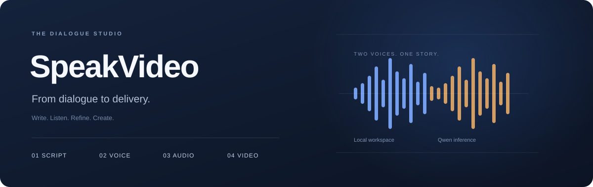
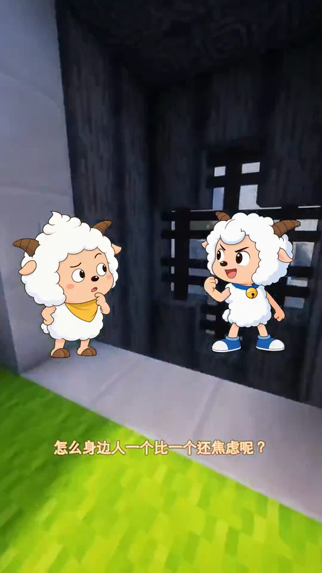
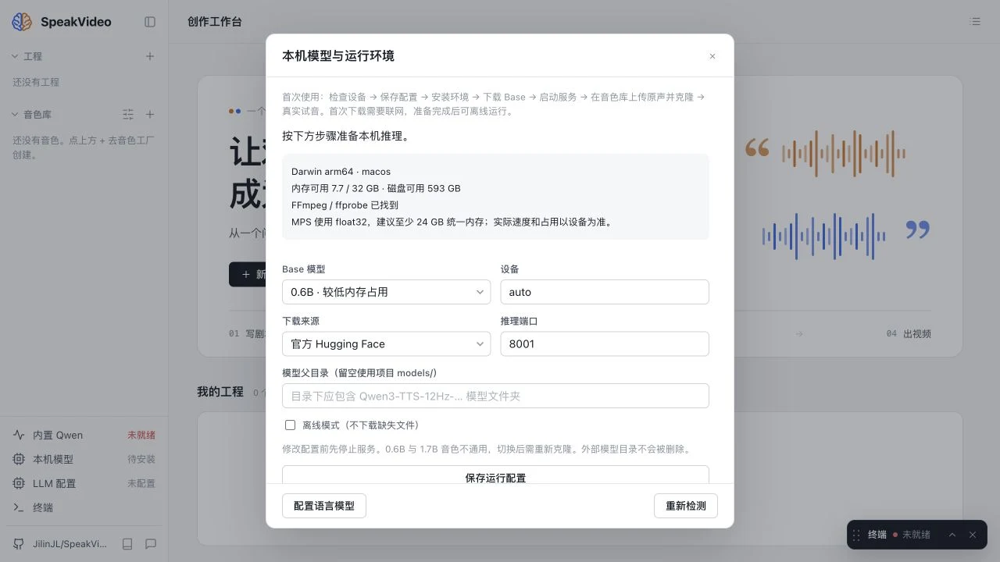
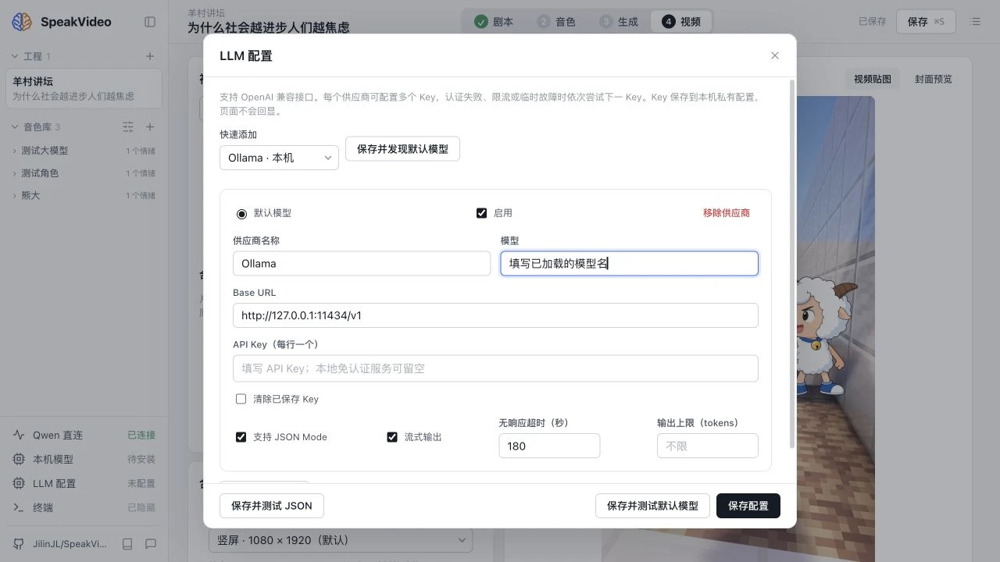
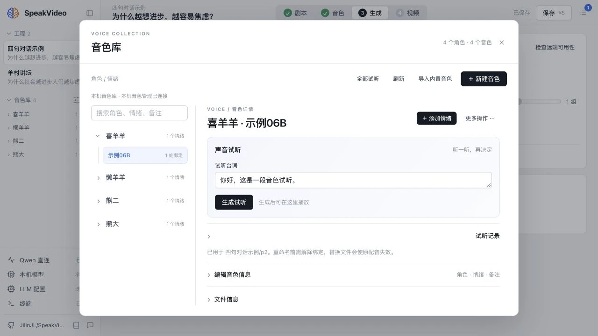
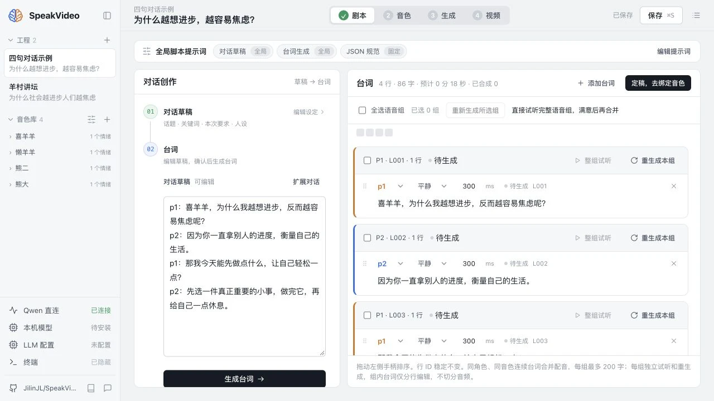
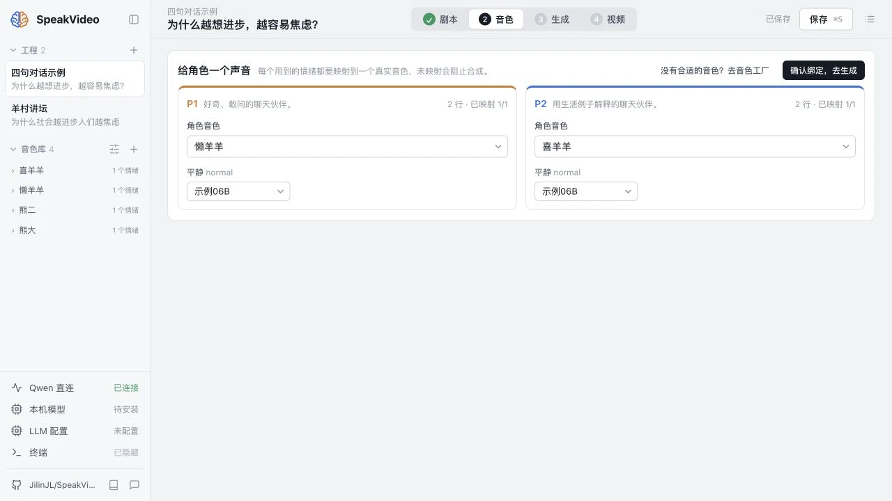
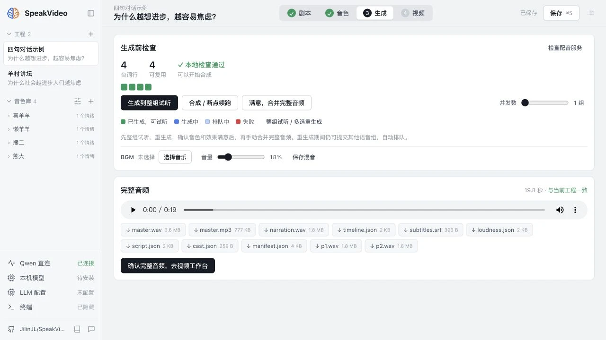
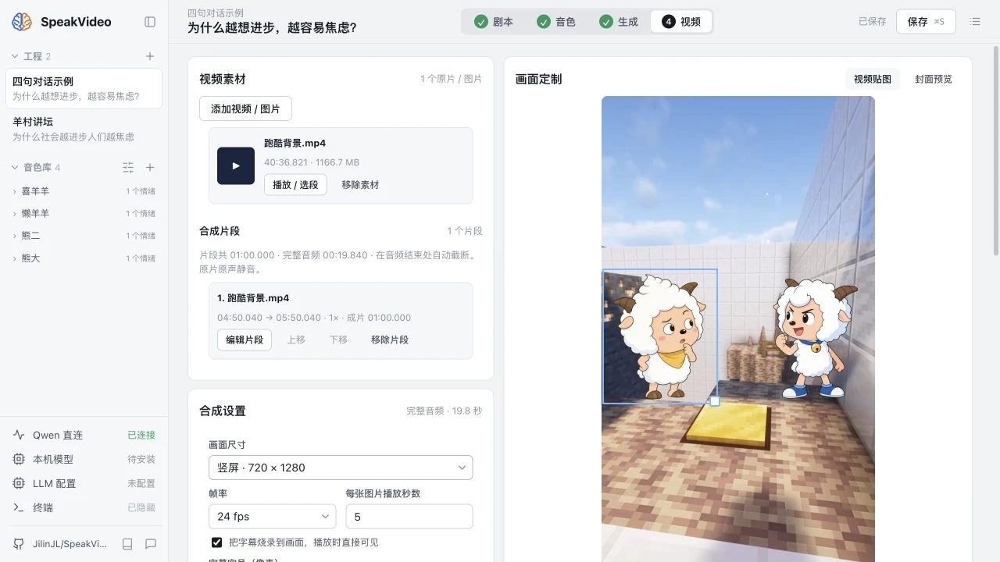
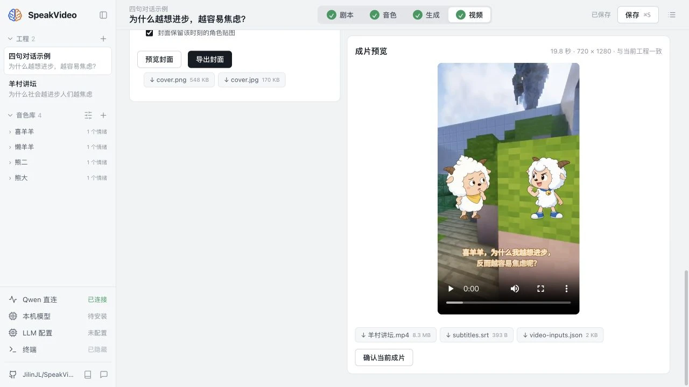

<div align="center">


# SpeakVideo

### AI 对话视频工作台 · Qwen3-TTS 本地语音克隆

自部署的 AI 视频生成与 TTS 语音合成工作台。基于 Qwen3-TTS 克隆声音，连接云端 API 或本地大语言模型，把双人剧本制作成带字幕的短视频；支持 macOS、Windows 和 Linux 的本机部署流程。

[](https://github.com/JilinJL/SpeakVideo/actions/workflows/check.yml) [](LICENSE)

[English](README.en.md) · [使用指南](docs/user-guide.md) · [部署与恢复](docs/deployment.md) · [验收状态](docs/acceptance.md)
</div>



**话题 → 对话草稿 → 台词 → 音色 → 配音 → 视频**

- **剧本**：云端 API 或自部署语言模型；流式草稿、全局提示词、结构化台词、手工编辑。
- **声音**：录音或上传原声克隆，按角色和情绪管理；描述音色需要另下载 VoiceDesign。
- **配音**：连续同音色台词按组合成、失败重试、有效音频缓存、WAV/MP3、BGM 与字幕。
- **视频**：图片与长视频素材、多片段剪辑、横竖屏、中文字幕、角色贴图随发言泛光、MP4 和封面。
- **本机模型**：页面内安装隔离的推理环境，下载、校验模型，管理服务和查看日志。

## 成品示例：羊村讲坛

**《为什么社会越进步，人们越焦虑》** · 懒羊羊 × 喜羊羊 · 完整作品 2 分 49 秒

<a href="docs/examples/yangcun-talk.mp4"></a>

**[▶ 观看完整 MP4](docs/examples/yangcun-talk.mp4)** · [直接下载](https://raw.githubusercontent.com/JilinJL/SpeakVideo/main/docs/examples/yangcun-talk.mp4)

这部视频取自作者本机已有工程，保留完整对话、角色贴图、背景画面和字幕；仓库中提供压缩展示版（540 × 960，约 27 MB），原始 1080 × 1920 成片保留在本机。播放入口未内嵌播放器时，点击链接打开视频文件或下载观看。

下面用同样的双人对话流程，从一个 **4 句短片** 开始，完成第一部自己的作品。

[安装启动](#快速开始) · [准备模型](#首次准备模型) · [内置音色](#内置角色音色) · [完整创作教程](#跟着做完成第一个作品)

## 支持范围

当前为**开源预览版**。Apple Silicon 已完成真实推理与视频导出；Windows / Linux NVIDIA 的独立安装与 GPU 推理仍待真实硬件验收。

| 平台 | 推理设备 | 资源门槛 |
|---|---|---|
| Apple Silicon macOS | 原生 arm64 / PyTorch MPS | float32，建议 24 GB 及以上统一内存 |
| Windows x86_64 | NVIDIA / CUDA | 0.6B 至少 4 GiB 显存；1.7B / VoiceDesign 至少 6 GiB |
| Linux x86_64 | NVIDIA / CUDA | 同上，需要 NVIDIA 驱动与可用的 `nvidia-smi` |

首次安装建议至少预留 **15 GB** 磁盘，额外模型和素材需要更多空间。门槛是环境检查策略，不是性能保证；各平台真实硬件验证记录见[验收状态](docs/acceptance.md)。纯 CPU、Intel Mac、AMD GPU、MLX 不在首版支持范围。不具备推理设备时仍可打开工作台编辑项目。

## 快速开始

先安装 [Git](https://git-scm.com/downloads) 与 [FFmpeg](https://ffmpeg.org/download.html)（必须同时包含 `ffmpeg` 和 `ffprobe`）。脚本自动准备 uv、Python 3.11 和项目环境，不修改全局 pip 配置。

```bash
git clone https://github.com/JilinJL/SpeakVideo.git
cd SpeakVideo
```

**macOS / Linux：**

```bash
bash scripts/install.sh
# 以后启动
bash scripts/start.sh
```

**Windows PowerShell：**

```powershell
powershell -NoProfile -ExecutionPolicy Bypass -File .\scripts\install.ps1
# 以后启动
powershell -NoProfile -ExecutionPolicy Bypass -File .\scripts\start.ps1
```

打开 **[127.0.0.1:8765](http://127.0.0.1:8765)**。Mac 也可双击 `start.command`，Windows 可双击 `start.cmd`。

### 首次准备模型

工作台「**本机模型**」按顺序完成：

1. 检查设备、磁盘与 FFmpeg，选择 **0.6B / auto** 或自己的设备。
2. 选择官方 Hugging Face 或 ModelScope 来源，保存配置。
3. 点击「安装 / 修复环境」，在独立虚拟环境安装 Torch 与 Qwen。
4. 下载 Base 模型，校验通过后启动服务。
5. 打开音色库，使用首次启动自动导入的示例音色；也可上传或录制原声，填写对应台词并克隆。
6. 点击真实试音或在音色库试听，确认后开始创作。

首次操作需要联网；进度与错误保存在本机，关闭页面后可重新查看。完整环境和模型会复用。下载失败可重试续传，也可手动切换来源。模型未准备好时，工作台仍可使用。

默认下载 `Qwen/Qwen3-TTS-12Hz-0.6B-Base`。可切换 1.7B Base；「描述音色」另需 `Qwen/Qwen3-TTS-12Hz-1.7B-VoiceDesign`。设备只驻留一个模型，切换可能需要时间。**0.6B 与 1.7B 的克隆音色不通用**，切换 Base 档位后请用原声重新克隆到新角色／情绪，或切回原档位。



### 配置语言模型

侧栏「**LLM 配置**」选择模板、填写模型并保存：

| 服务 | Base URL | API Key |
|---|---|---|
| 云端兼容服务 | 供应商提供的 `/v1` 地址 | 自己的 Key |
| Ollama | `http://127.0.0.1:11434/v1` | 免认证时留空 |
| LM Studio | `http://127.0.0.1:1234/v1` | 按服务认证设置 |
| vLLM / 自定义 | 例如 `http://127.0.0.1:8000/v1` | 按服务认证设置 |

本地 LLM 需由用户先安装、加载模型并开启兼容 OpenAI 的服务。SpeakVideo 提供模型发现、文本测试和 JSON 测试；发现不可用时可手填模型名。模型不支持 JSON Mode 时关闭该选项，再测试结构化输出。实际台词仍经过格式校验。



**不绑定 LLM 也能手写／导入剧本并制作配音视频。** 模型和字体准备完成、语言模型也在本地时，可以断网创作。Key 只经后端调用，不回显到页面，不进入 Git。

## 内置角色音色

仓库内置 **熊大、熊二、喜羊羊、懒羊羊** 四个角色的 PT，每个角色分别提供 **0.6B 和 1.7B** 版本。第一次启动会把当前 Base 档位的四个示例复制到本机音色库，未下载模型也能先查看和绑定；试听和配音仍需准备模型。

| 角色 | 来源情绪 | 音色库中的名称 | 用法示例 |
|---|---|---|---|
| 熊大 | 阐述 | 示例06B / 示例17B | 解释、总结 |
| 熊二 | 吐槽 | 示例06B / 示例17B | 提问、轻松对话 |
| 喜羊羊 | 询问 | 示例06B / 示例17B | 问答搭档 |
| 懒羊羊 | 平静 | 示例06B / 示例17B | 日常聊天 |

**默认 0.6B 请选「示例06B」；1.7B 请选「示例17B」**。两种模型的 PT 不能混用。切换 Base 档位后，会补充相应示例；已有同名文件保留，用户自行修改的音色不会被覆盖。删除后可在「音色库 → 导入内置音色」恢复，命令行也可执行：

```bash
uv run speakvideo voices examples
```

PT 使用受限加载的数据格式。1.7B 版由作者本机提供的旧音色转换；0.6B 版由 1.7B 合成的参考片段重新克隆，声音表现可能有差异。文件与校验清单见 [example-voices](speakvideo/assets/example-voices/manifest.json)，素材来源与许可边界见 [NOTICE](speakvideo/assets/example-voices/NOTICE.md)。



## 跟着做：完成第一个作品

教程使用「羊村讲坛」的双人问答形式。**首次先做 4 句，确认声音与画面后再扩展成长视频**。以下截图来自实际工作台，演示工程和完整成片的长度可以不同。

### 1. 新建工程，确定一句话题

点击侧栏「＋」，工程名填写 `我的羊村讲坛`，话题填写 **为什么越想进步，越容易焦虑？**。关键词可填 `比较、焦虑、生活节奏`。

有 LLM 时，先按上面的配置方法保存供应商，再在「剧本」填写本次要求，例如：

```text
写一段轻松的双人问答，先做 4 句。
P1 好奇地提问，P2 用生活例子解释。
主题：为什么越想进步，越容易焦虑？
最后给一个今天就能做的小建议，避免口号。
```

点击「生成草稿」，读一遍并修改，再点「生成台词」。生成后可直接逐行改字、调整角色、情绪和句后停顿。**满意后点击「定稿，去绑定音色」**。



### 2. 没配 LLM？直接写这四句

点击「添加台词」，按顺序填写；情绪都先用「平静」，减少首次映射工作：

| 角色 | 台词 |
|---|---|
| P1 | 喜羊羊，为什么我越想进步，反而越容易焦虑呢？ |
| P2 | 因为你一直拿别人的进度，衡量自己的生活。 |
| P1 | 那我今天能先做点什么，让自己轻松一点？ |
| P2 | 先选一件真正重要的小事，做完它，再给自己一点休息。 |

每行保留默认约 300 ms 停顿即可。也提供可验证的 [script.json](docs/examples/first-dialogue/script.json) 和 [cast.json](docs/examples/first-dialogue/cast.json)：先新建工程并停止编辑，将两份文件复制到 `projects/我的羊村讲坛/` 对应文件，再刷新页面。绑定示例按默认 0.6B 配置。

### 3. 绑定懒羊羊与喜羊羊，先试听

在「音色」步骤设置：

| 对话角色 | 音色角色 | 平静对应音色 |
|---|---|---|
| P1 · 橙色提问者 | 懒羊羊 | 示例06B |
| P2 · 蓝色回答者 | 喜羊羊 | 示例06B |

如果台词使用了「追问」「严肃」等其他情绪，也要逐项选音色；第一部作品可以全部映射到同一个示例 PT。打开音色库，输入一小句试听，确认声音后回到工程，点击「确认绑定，去生成」。想换熊大、熊二时，只需更换这里的角色。



### 4. 生成配音，逐组听，再合并

进入「生成」，先确认本地检查通过，再点击「合成 / 断点续跑」。等待完成后逐组试听；某组效果不好，点击该组的「重新生成本组」，无需把整部作品重新配音。

全部满意后点击「满意，合并完整音频」，试听完整音频。可上传 BGM 并降低音量，确认没有盖过人声，再重新合并。此处可下载 WAV、MP3 和 SRT；点击「确认完整音频，去视频工作台」继续。



### 5. 排画面、加字幕与角色贴图

进入「视频」：

1. 点击「添加视频 / 图片」，上传一张背景图或一段视频；长视频用「播放 / 选段」选起止位置，再加入片段，可调整顺序与速度。
2. 第一部选 **竖屏 720 × 1280 / 24 fps**；确认效果后再导出 1080 × 1920。背景原声会静音，使用前面合并的配音。
3. 勾选「把字幕烧录到画面」。P1 为白字橙色描边，P2 为白字蓝色描边；手机观看时检查字号和位置。
4. 可选：上传透明角色贴图，拖动位置和大小。把左侧角色绑定 P1、右侧角色绑定 P2，勾选「该角色发言时自动泛光」。角色图片由用户自行提供。
5. 点击「保存视频设置」。修改画面或字幕后，已有有效配音会继续复用。



### 6. 导出 MP4，检查成片

点击「合成并导出视频」。完成后在「成片预览」播放，检查开头、角色换人、字幕和结尾，再点击 MP4 下载链接（文件名随标题变化）。需要标题封面时，在「定制封面」填写标题、副标题，选择画面，先预览再导出。

最终得到：

```text
羊村讲坛.mp4    可发布的视频（使用你的标题命名）
master.wav     无损完整配音
master.mp3     压缩完整配音
subtitles.srt  字幕文件
cover.png/jpg  可选封面
```



如果「合成并导出视频」不可用，返回「生成」完成有效音频的合并；音色缺失则回「音色」补齐角色与情绪映射。模型报错时从「本机模型」查看日志，修复后继续当前工程。

## 模型、数据与更新

| 目录 | 内容 |
|---|---|
| `projects/` | 工程、素材、音频缓存与成片 |
| `voices/`、`voice-previews/` | 本机音色、原声与试听历史 |
| `models/` | 模型权重，也可在页面设置外部模型父目录 |
| `runtime/` | 推理虚拟环境、配置、服务身份与日志 |
| `.cache/` | 私有 LLM 配置、任务和工作缓存；不要当作全部可丢弃的临时文件 |

这些运行目录、`config.local.toml` 和 `script-prompts.json` 均不提交。仓库只包含上面明确列出的示例音色和压缩展示视频。升级前备份自己的数据；服务退出不删除模型或作品。停止任务和推理后执行 `git pull --ff-only`，再重跑安装脚本。

旧 PT 仅能显式执行可信转换，或使用原声重新克隆，详见[迁移说明](docs/deployment.md#旧版迁移)。

## 开发

```bash
uv sync --locked --python 3.11
uv run pytest -q
uv run ruff check speakvideo tests scripts
uv run ruff format --check speakvideo tests scripts
node --check speakvideo/static/app.js
node --check speakvideo/static/runtime.js
uv build
```

常规 CI 覆盖三平台工作台及模拟测试，真实 MPS/CUDA 验收单独记录。`uv run speakvideo demo` 仅生成测试音，不代表真实 TTS 验收。

[贡献指南](CONTRIBUTING.md) · [运行环境 API](docs/implementation.md) · [公开前检查](docs/release.md)

## 许可证

SpeakVideo 源码采用 [Apache-2.0](LICENSE)。模型、字体和移植代码遵循各自许可，见[第三方说明](THIRD_PARTY_NOTICES.md)。内置角色音色和成片中的第三方角色、声音与背景素材不因此转为 Apache-2.0 授权，见[示例素材说明](docs/examples/NOTICE.md)。
